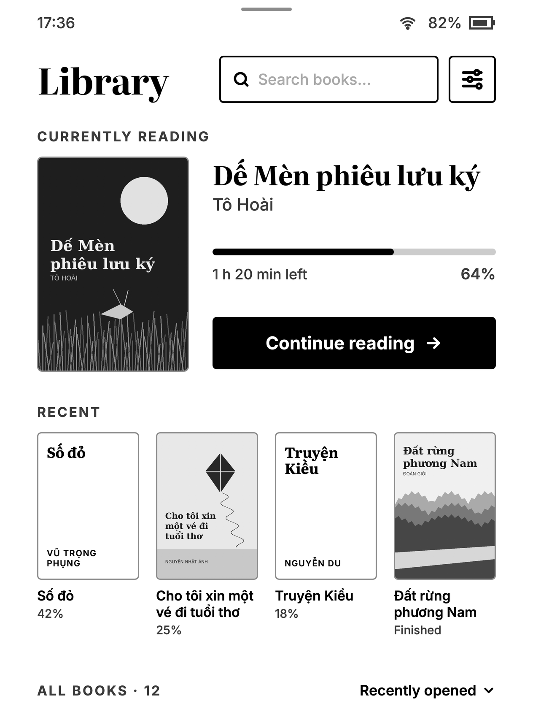
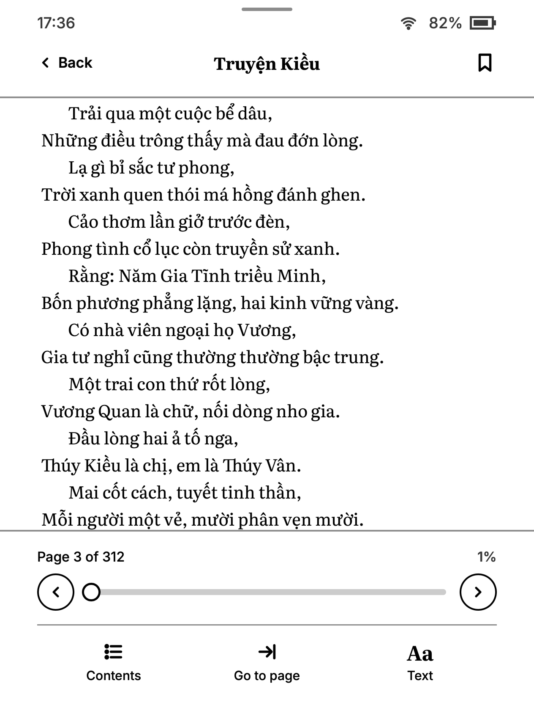
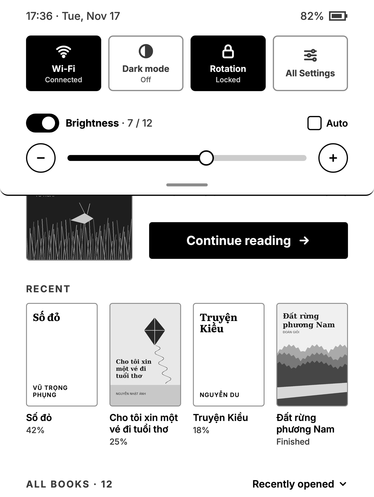
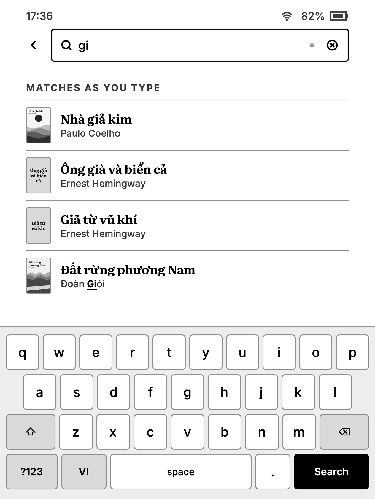

# Minimal Home for KOReader

A calm, minimal home screen and reading screen for e-ink readers running
[KOReader](https://github.com/koreader/koreader). Designed on a Kindle Oasis 2;
sizes scale to any screen KOReader runs on.

| Home | Reading | Reading menu |
|---|---|---|
|  |  |  |
| **Quick panel** | **Search** | **Sleeping** |
|  |  |  |

Pictures are design mockups (1264 × 1680, the Oasis 2 screen). On the device
the plugin looks very close, but not pixel for pixel the same.

> **Source published, contributions not accepted.** This is a personal project,
> shared as-is. Found a bug or have an idea? Post it in
> [Discussions](https://github.com/truonglong88/Minimal-Home-Interface-for-Kindle/discussions): it's read, but there is no promise of a fix or a reply.
> Pull requests are not accepted. You are welcome to fork it and change
> anything you like under the [license](#license).

## Who is this for

**A good fit if you:**
- read mostly your **own book files** (EPUB, PDF, FB2…: from local bookshops,
  publishers, Calibre, public-domain sites), not books bought from the Kindle Store;
- rarely buy from Amazon, or don't mind opening those books in the Kindle's own
  reader (*Exit to Kindle* is one tap; KOReader can't open DRM-protected Kindle books);
- **accept the risks of jailbreaking** your Kindle (see below);
- are fine with a bit of tinkering now and then: copying files over USB,
  maybe SSH for updates;
- want a quiet, simple reading device more than lots of options.

**Probably not for you if you:**
- read mainly Kindle Store or Kindle Unlimited books, or rely on Whispersync,
  Goodreads, X-Ray, Audible or other Amazon features while reading;
- want something officially supported, or can't afford to lose the device;
- don't want to jailbreak, or need the Kindle's warranty and automatic updates.

**About jailbreaking.** KOReader runs on a Kindle only after a jailbreak.
It is not supported by Amazon and is done at your own risk: it may void the
warranty, a mistake can leave the device unusable, firmware updates must be
blocked or they can remove it, and Amazon can change things at any time. The
Kindle's own reader and store keep working alongside KOReader. This project
does not provide or support jailbreaks; see [Install KOReader](docs/install-koreader.md)
for where to read about them.

## Features

**Home**
- *Currently reading* with progress, time left and a big *Continue reading* button
- *Recent* books and *All books*, sortable by recently opened, recently added, title or author
- Search by title or author as you type, accents optional
- After finishing a book: a suggestion for what to read next
- Hold a book to delete it from the device (asks first)
- Kindle-only books (DRM'd AZW/KFX) are tagged instead of showing garbage

**Reading**
- Clean page: clock on top, *time left in chapter* at the bottom, even margins
- Tap the middle for the reading menu: page slider with ‹ › one-page steps,
  Contents, Go to page (number keypad), Font panel (font, size, line spacing,
  margins, alignment)
- Swipe down from the top for the quick panel; swipe up from the bottom to go Home
- KOReader's own menus and gesture shortcuts are switched off on the page; page
  turns, links, footnotes and long-press on a word (dictionary, highlight) still work

**Quick panel and Settings**
- Wi-Fi, Dark mode, Rotation lock, brightness with Auto (light sensor)
- Wi-Fi popup: networks nearby, join saved ones with a tap, our own password keyboard
- Settings: screensaver, default font, page-turn buttons, full refresh, sleep timer, SSH

**Everywhere**
- One keyboard for every text field: letters / numbers, Vietnamese Telex or English
- One message style (snackbar) and one confirm dialog, for KOReader's messages too
- Battery care: Wi-Fi and the front light are switched off while the device
  sleeps and restored when it wakes

More in [docs/features.md](docs/features.md).

## Requirements

- A device running **KOReader v2026.07 or newer**. On a Kindle this needs a
  jailbreak first: see [Install KOReader](docs/install-koreader.md).
- Tested on a Kindle Oasis 2 (9th gen). Other KOReader devices should work, but
  are untested.

## Install

1. Download `minimalhome-x.y.z.zip` from [Releases](../../releases).
2. Connect the device by USB and unzip it into `koreader/plugins/`, so you get
   `koreader/plugins/minimalhome.koplugin/`.
3. Restart KOReader. Minimal Home opens instead of the file browser.

Details, updating over Wi-Fi and uninstalling: [docs/install-plugin.md](docs/install-plugin.md).

## Gestures

| Where | Gesture | Does |
|---|---|---|
| Home | tap a book | open it |
| Home | hold a book (All books) | delete it (asks first) |
| Home, Settings | swipe down from the top | quick panel |
| Settings | swipe up from the bottom | back to Home |
| Settings pages | swipe right | back |
| Reading | tap the middle | reading menu |
| Reading | tap the left / right edge, swipe sideways, page buttons | turn pages |
| Reading | swipe down from the top | quick panel |
| Reading | swipe up from the bottom | back to Home |
| Reading | tap the bottom-left corner | switch *time left*: chapter / book / off |
| Reading | hold a word | dictionary, highlight (KOReader) |
| Status bar | hold | screenshot |

## Images

The screensaver pictures in `minimalhome.koplugin/screensavers/` and the book
covers visible in the mockups are **not licensed for redistribution**. They
are included for personal use only, to show what the plugin looks like. They are
not covered by this project's license. If you fork or redistribute this project,
replace them with images you have the right to share
(`tools/prepare-screensaver.py` turns any picture into a screen-sized grayscale
image). See [docs/images/NOTICE.md](docs/images/NOTICE.md).

## Feedback

- **Bug reports, ideas, questions:** [Discussions](https://github.com/truonglong88/Minimal-Home-Interface-for-Kindle/discussions). For a bug, say which
  device, KOReader version and Minimal Home version (shown at the bottom of
  Settings), what you did and what happened; a screenshot helps (hold the status
  bar). Lines with `MinimalHome` from `koreader/crash.log` help most.
- No promise of fixes, replies or new features: this is a personal project.
- Issues are off and pull requests are closed automatically; forks are welcome.

## Development

See [docs/development.md](docs/development.md): project layout, tests, packaging.

## License

[AGPL-3.0](LICENSE), the same license as KOReader. Forks are welcome under its
terms (share your changes under the same license).

Bundled fonts: [Literata](minimalhome.koplugin/fonts/OFL-Literata.txt) and
[Inter](minimalhome.koplugin/fonts/OFL-Inter.txt), both under the SIL Open Font
License. Images: see [Images](#images).

Not affiliated with KOReader or Amazon. Kindle is a trademark of Amazon.com, Inc.
