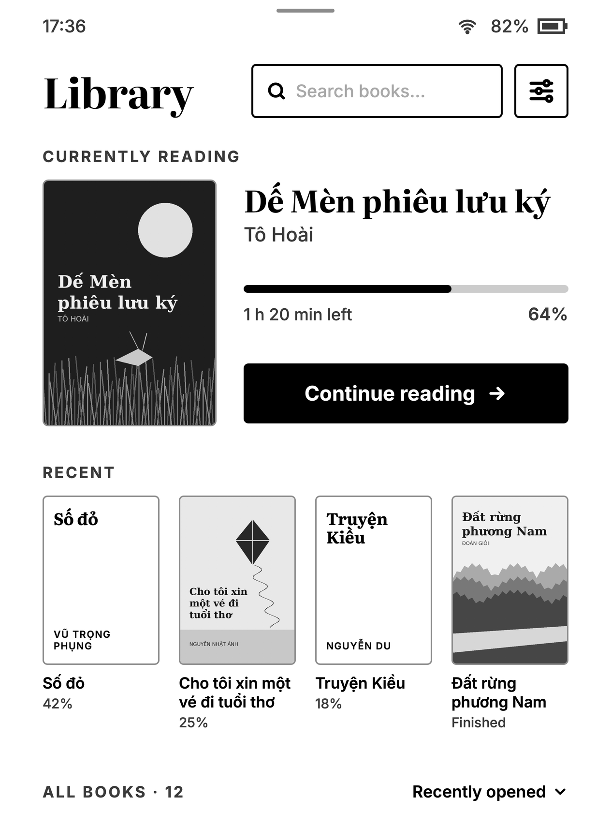
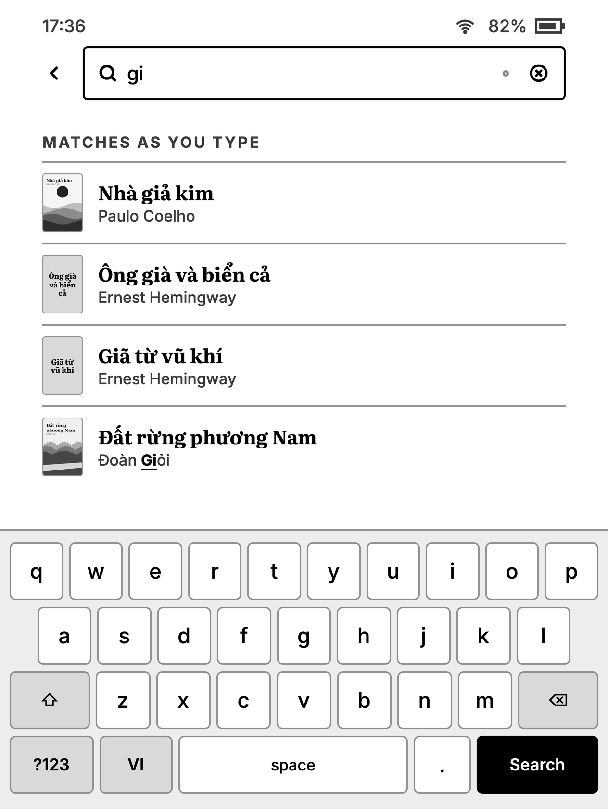
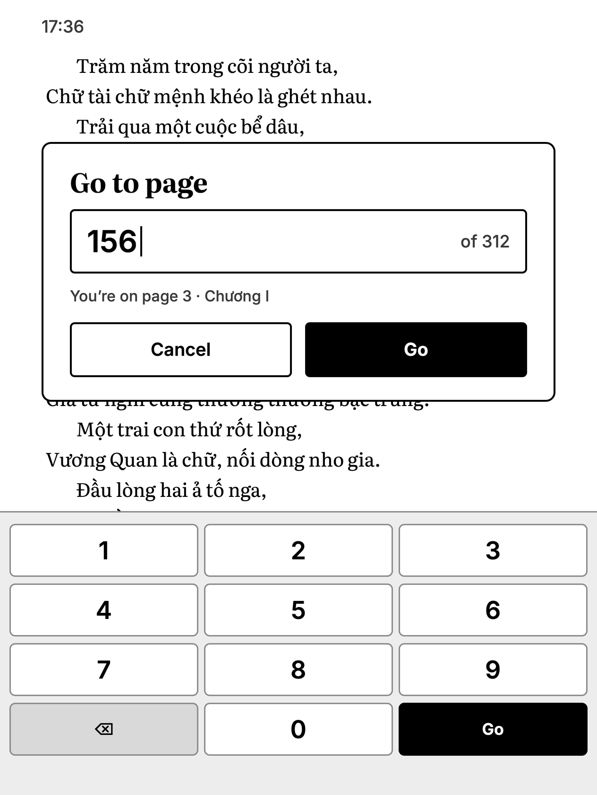
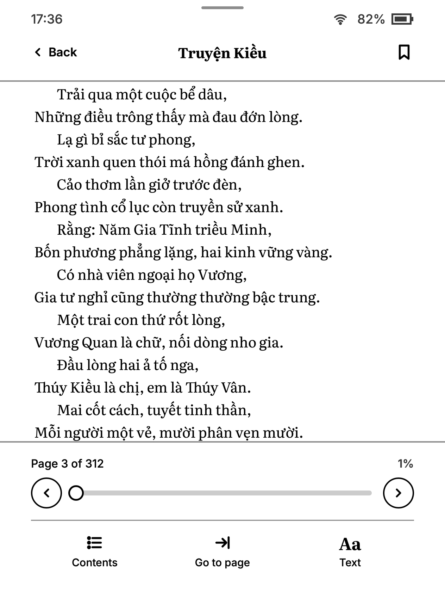
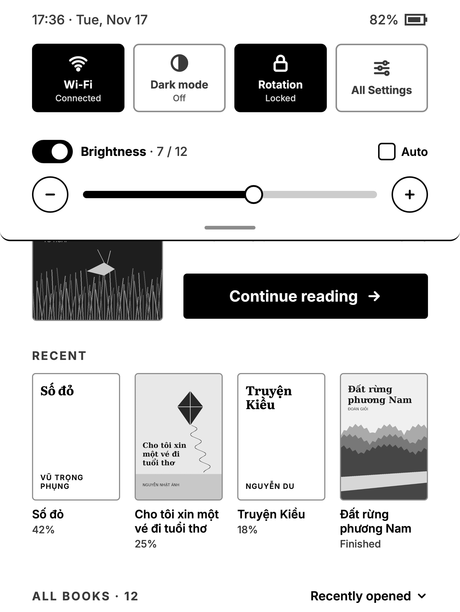
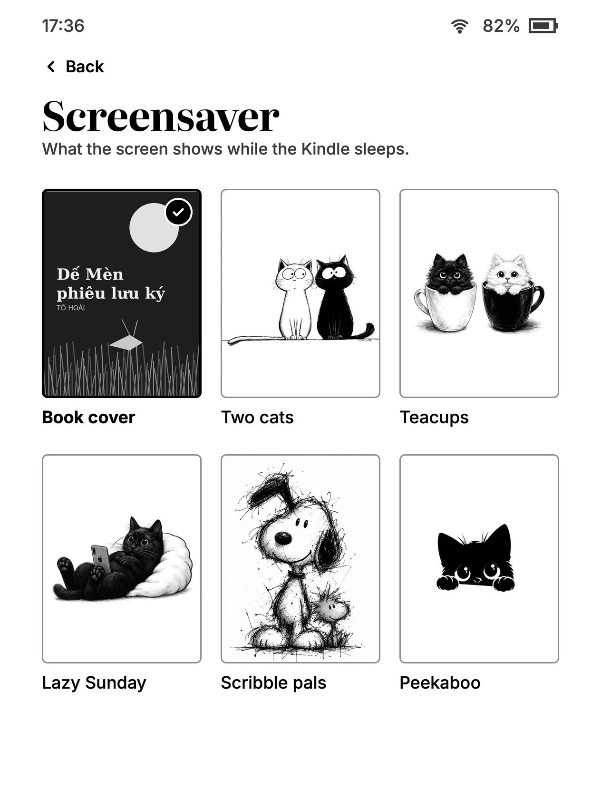

# Features

Pictures are design mockups at the Kindle Oasis 2 screen size (1264 × 1680); the plugin on a device looks very close, but not pixel for pixel the same.

## Home

- **Currently reading**: cover, title, author, progress bar, time left, *Continue reading*.
- **Start reading**: before any book is opened, the newest one is suggested.
- **Recent**: the last four books opened.
- **All books**: every book, with format, pages and progress. Sort by recently
  opened, recently added, title or author; tap the current order again to reverse.
- **Search**: the box at the top. Matches titles and authors as you type,
  accents optional; *Search* shows all results.
- **Delete**: hold a book in All books, confirm. The file and its reading data are
  removed; the list stays where it was.
- **Kindle-only books**: DRM'd AZW / KFX files are tagged *KINDLE ONLY*; tapping
  explains they open in the Kindle reader.
- **Empty library**: explains how to add books.

## Reading

- Clock at the top, *time left in chapter* at the bottom (tap the bottom-left
  corner to switch to time left in book, or nothing). Same room above and below the text.
- **Reading menu** (tap the middle): title, bookmark, page slider with ‹ › for one
  page, Contents, Go to page, Font.
- **Contents**: opens at the chapter being read, scrollbar, *Back to top*.
- **Go to page**: number keypad.

- **Font panel**: font for this book, size, line spacing, margins, alignment.
- **Finished**: a summary screen at the end of a book, with what to read next.
- KOReader's own menus and gesture shortcuts don't open on the page. Page turns,
  links, footnotes and long-press on a word (dictionary, highlight) still work.

## Quick panel

Swipe down from the top of Home, a book or Settings.
Wi-Fi, Dark mode, Rotation lock, All Settings, and brightness with an on/off
switch, − / + and Auto (follows the light sensor; shows the level it picked).

## Settings

- **Wi-Fi**: a popup with the network in use and the others nearby. Tap a saved or
  open network to join; a new one asks for its password (shown as typed, *Hide* to
  mask it). A message says whether it worked.
- **SSH access**: for updating over Wi-Fi; shows the address and port.
- **Full refresh**, **Screensaver** (book cover or one of the pictures), **Default font**, **Swap page-turn buttons**, **Sleep after**.
- **All KOReader settings**: KOReader's full menu, if you need it.
- *Restart KOReader*, *Exit to Kindle*.

 

## Keyboard

Letters and numbers / symbols, ⇧ for one capital, ⌫ (hold to clear), VI (Telex,
KOReader's engine) / EN, and a black action key (*Search*, *Join*, *Go*); a number
keypad for page numbers. See the Search and Go to page pictures above.

## Battery

- Wi-Fi turns off while the device sleeps and comes back on when it wakes, if it was on.
- The front light turns off while the device sleeps (no lit screensaver at night)
  and comes back at the same level.
- Auto brightness checks the sensor once a minute, only changes the light when
  the level changes, and pauses while asleep.
- The clock is redrawn once a minute (a small strip), and not while asleep.
